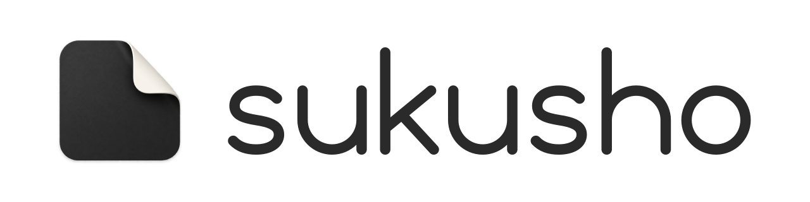
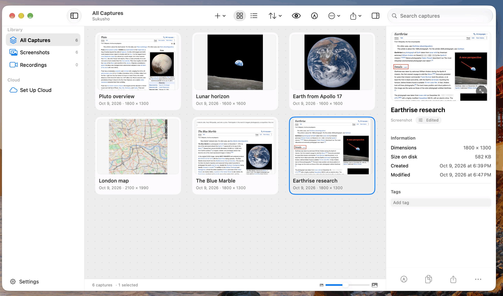
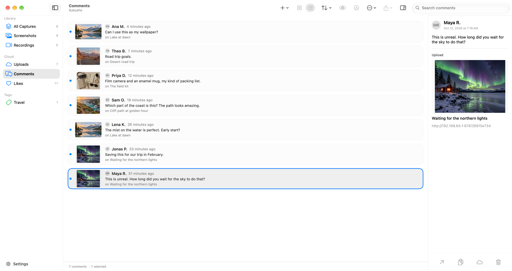
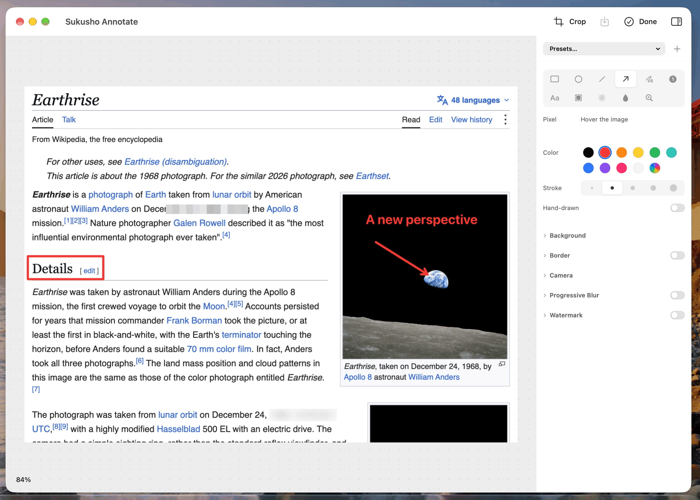
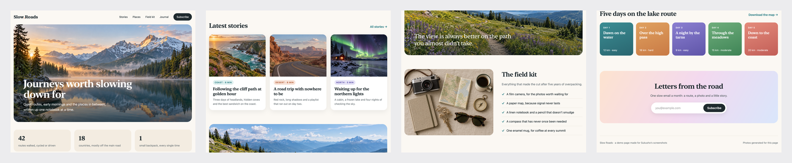

<h1 align="center">
  <picture>
    <source media="(prefers-color-scheme: dark)" srcset="docs/brand/readme-header-dark@2x.png">
    
  </picture>
</h1>

Sukusho is a native macOS app for screenshots, scrolling captures and screen recordings. Its Library brings together your captures, Cloud uploads, comments and likes; Studio edits your recordings, and the image editor adds annotations, pictures and backgrounds. Share links are served from your own Cloudflare Worker.

Sukusho started as a fork of [Screendrop](https://github.com/fayazara/Screendrop) by Fayaz Ahmed, and thanks go to that project for the foundation. It has since grown into a separate project: a heavily modified app with its own features, its own name and app identity, and its own Cloudflare Worker for share pages. The two apps install side by side and don't share updates.

> [!IMPORTANT]
> Sukusho is not affiliated with or supported by Screendrop or its author. Please report Sukusho problems here, not to the Screendrop project.

> [!NOTE]
> There are no releases yet. To use Sukusho, [build it from source](#building-from-source). It is under active development, so expect rough edges.

## Screenshots

The Library keeps captures together, with a grid, tags and an inspector for the selected image, next to your Cloud uploads, comments and likes.



Comments left on your share pages arrive in the Library, newest first by default, each with the upload it's on.



The editor sets a capture on a background, with a camera angle and progressive blur, and annotates it with arrows, text, shapes, pixelation and blur.



Scrolling Capture turns a whole page into one image. Auto-scroll captured this demo page from top to bottom and finished by itself; it's split into four columns here to fit.



## Features

### Cloud uploads, comments and likes

Sharing is optional and self-hosted: uploads go to a Cloudflare Worker you deploy, which keeps files in R2 and metadata in D1. Sukusho only needs the Worker's URL and an upload token.

- **Share pages:** recordings get a video player with captions, a searchable transcript and scrub previews; screenshots get a clean viewer. Pages show view counts and rich link previews in chat apps.
- **Comments and likes** from viewers appear in the Library beside your uploads. Enable or disable them per share, and choose whether comments can be anonymous.
- **Share Options:** a title, a link expiry, an optional password, and whether comments and likes are allowed. **Settings → Cloud** sets the default link expiry and the share page's name, logo and favicon.
- Edited recordings upload the finished cut, followed by its poster, transcript and scrub previews.

### Library

One window for screenshots, recordings and recording projects, with **Uploads**, **Comments** and **Likes** beside them:

- Cards with an adjustable size, search, and filters for screenshots or recordings. Tags have their own colours and icons.
- A trimmed toolbar: search sits just left of the inspector toggle at the far right. **Command + F** focuses search. Right-click a capture for **Quick Look**, **Edit**, **Rename**, **Revert to Original…** (on an edited capture or recording draft, with confirmation), **Copy**, **Export…** (and **Export as GIF…** for a recording), the system **Share…** sheet, **Reveal in Finder** and **Move to Trash**.
- The same capture menu holds its cloud actions: **Share to Cloud…** before upload; **Copy Cloud Link**, **Open Shared Capture** and **Delete from Cloud…** once shared.
- Right-click between the cards to choose the sort order or **Refresh**, on the captures, Uploads, Comments and Likes pages. **Command + R** refreshes the current page.
- Capture cards show a cloud badge when Cloud is set up or the capture is already shared. Click it to share an unshared capture or copy an existing share link; shared captures have a green cloud with a tick.
- An inspector with dimensions, dates, duration, disk use and tags. **Space** opens Quick Look, **Return** renames, and multi-selection supports copying, exporting, sharing, revealing and moving captures to Trash.
- Cloud uploads open their share links; comments and likes arrive from your share pages, newest first by default, with the capture each belongs to.
- A storage bar beside the sidebar's Settings gear shows cloud use against the **Storage threshold** in **Settings → Cloud**. It turns amber at 80% and red at the threshold; it warns without limiting uploads.

Normal launches open the Library; launching at login stays quietly in the menu bar.

### Editor

Editing is non-destructive. The untouched image and an editable sidecar are kept side by side, so annotations and pasted pictures can be reopened and changed later. Exports render at the image's full resolution. There is no Save button: edits save after a two-second idle pause once the current gesture or canvas text edit finishes, when you close the window or quit, when you switch to another window or app, or with **File → Save** (**Command + S**). Idle saves leave the clipboard alone, and saving never adds preview cards.

The title bar shows the capture's name or date, with **Edited**, **Saving…** or **Saved** beneath it. Double-click the title to rename a capture in the Library; clearing the name restores its date. Renaming changes its Library name, leaving the file name and saved edits alone. **File → Revert To → Original** restores the capture as taken, without annotations, crop or background; **Last Opened** restores how the window opened. Either can be undone while the window is open.

- **Floating tool dock:** Select, rectangle, ellipse, highlight, arrow, straight line, freehand, text, numbered circle, magnifier, pixelate and blur sit above the canvas, followed by **Crop**, the **eyedropper**, **Measure**, and a **colour/size pill**. The pill changes the selected annotation's colour and line width or text size, or the armed tool's settings when nothing is selected.
- **Place a shape, then adjust it:** shapes, arrows, lines, magnifiers and redactions return to Select with the new annotation selected. Text returns to Select when editing finishes. Freehand and numbered circles stay armed for drawing strokes or placing a run of numbers, with the newest annotation selected.
- **Smoother freehand:** stronger smoothing while drawing and when finishing a longer stroke reduces jitter while keeping its endpoints in place.
- **Paste pictures:** **Command + V** adds an image from the clipboard, selected and ready to move or resize. Corner handles keep its aspect ratio unless Shift is held; side handles stretch it. With no background, camera effect or bleeding blur, dragging a picture past the screenshot's edge grows the canvas to fit it.
- **Eyedropper:** arm it and click the image to copy the pixel's hex colour. **Tab** also copies the colour under the pointer when the canvas has keyboard focus.
- **Measure:** hold **1** for height or **2** for width under the pointer, or arm the ruler for a crosshair showing both. Clicking while measuring does not stamp an annotation or draw a shape. Escape disarms the ruler.
- **Crop:** use the dock's Crop button or **C** for a freeform or fixed-ratio crop at full resolution. With Select armed, **Command-click** the image to start a crop around the box under the pointer, then adjust or confirm it. Annotations follow the crop.
- **Snapping and editing:** move and resize annotations, snap to other shapes and the image's edges and centre with alignment guides, and undo or redo changes.
- **Smart Redaction** finds sensitive text and blurs or pixelates it, with editable strength.
- **Inspector:** the **Styles** row opens a pop-out grid of look thumbnails. Click a style to apply it, or the **+** tile to name and save the current look. **Import…** sits in the footer; each style's right-click menu offers **Export…**, a default for new screenshots, and Delete. Import and export use `.screendroppreset` files. **Background** opens a picker beside the inspector, with colour and gradient hover previews. The **Screenshot** group labels padding, corners and shadow, and the fields are pills. Style controls appear only when the current tool or selection has something to adjust.
- **Backgrounds and effects:** colours, gradients, wallpapers or your own images, padding, corner radius, shadow, border, watermark, perspective and progressive blur.
- **Unsplash wallpapers:** the Background picker's **Wallpaper** library offers search using your own [Unsplash Access Key](https://unsplash.com/oauth/applications), stored in the Keychain. Choose a result to download and use it, with photographer credits beside the results. Recent wallpapers and images you choose remain available; the old wallpaper packs are gone.

### Screen recording and Studio

- Record a display, a window or an area, with a camera, a microphone and system audio as separate sources, a start timer, and a teleprompter that follows your narration on-device.
- A floating bar pauses, restarts, stops or discards the recording.
- Every recording is a non-destructive project. In Studio, cut and trim clips, change speed, add automatic or manual zooms, a reconstructed cursor, click highlights and keystroke captions, move and resize the camera, and pick a background and an aspect ratio for social formats.
- **Crop** sits in the canvas's upper-right corner; while cropping, its aspect ratio, Cancel and Crop controls appear in the toolbar.
- **Inspector:** **Styles** opens the same pop-out grid as the image editor, its thumbnails drawn from the recording, with **Import…** in the footer and **Export…** in each style's right-click menu. Studio's styles are kept apart from screenshot styles, and a style file opened in the wrong editor is refused with a note saying where to import it. **Background** opens a picker beside the inspector that previews a fill on the video while you hover it, followed by the aspect ratio and the video's padding, corners and shadow (shadow needs a background).
- Studio has no Save button: a project saves after a two-second pause in editing, when you switch to another window or app, when you close it or quit, and with **File → Save** (**Command + S**). Its subtitle shows **Edited** or **Saved**. Double-click the title to rename the project; unnamed recordings show their date, matching the Library. **File → Revert To → Original** resets every edit to how a new recording opens, and **Last Opened** to how the window opened; either can be undone. To throw a recording away, move it to the Trash from the Library.
- Transcribe narration on-device, edit captions, or cut the video by deleting words from its transcript.
- Export the finished composition as MOV, MP4 or GIF, or use **Upload** to send it straight to your Worker and copy its share link.

### Capture

Capture a display, a window, an area, a scrolling region, or just the text in an area. Sukusho runs from its menu bar item and global shortcuts:

| Default shortcut | Action |
| --- | --- |
| `Command + Shift + 3` | Capture full screen |
| `Command + Shift + 4` | Capture an area |
| `Command + Shift + 5` | Screen recording |
| `Command + Shift + 2` | Capture a window |
| `Command + Shift + 6` | Capture Text to the clipboard |
| `Command + Shift + 7` | Scrolling Capture |

The first three are macOS's own screenshot shortcuts, so turn those off in macOS's keyboard shortcut settings (under Screenshots) for Sukusho to get them.

Change any of them in **Settings → General**. If a shortcut can't be registered, Settings says why and keeps the previous one.

- **Screenshot options:** a 3, 5 or 10 second timer, optional window shadows, PNG or JPEG, an export folder, and a Save action that can skip the save panel.
- **After each capture**, choose any of: show the preview, copy, save, upload and copy the link, open the editor, or pin the screenshot above other windows.
- **Floating preview cards** let you copy, drag, save, compress, pin, Quick Look, edit, upload or delete a capture. Their actions can be rearranged in **Settings → Overlay**.
- **Capture Text** drags out an area, reads its text on-device with Vision, and puts the text on the clipboard. No image is saved.
- **Open With → Sukusho** in Finder imports a copy of an image and opens the copy in the editor. The original file is never changed.

### Scrolling Capture

Draw a box over a scrolling view, then scroll through it yourself or click the auto-scroll button on the capture bar. Sukusho lines up each new frame with the last one and adds only the rows that scrolled into view, giving one tall image up to 16,384 pixels high.

- **Auto-scroll** moves the view a step at a time, paced by what has been captured, and finishes the capture by itself at the end of the page. It pauses while a frame doesn't fit and carries on once one does. Scrolling yourself or moving the pointer off the bar hands control back to you. Auto-scroll needs the Accessibility permission; the bar offers to open it.
- **Every frame is checked before it's added.** Apple's Vision framework proposes where the new frame fits, and Sukusho adds it only once an exact pixel match confirms it. A frame that doesn't fit is skipped, not joined in the wrong place.
- **The capture bar** stays quiet through brief misses. If frames keep failing to fit, it says **Scroll back a little** when the view has moved past where it can line up, or **Something on the page keeps changing** for a video, an animation or a hover.
- **Done**, or `Command + Shift + 7`, keeps everything captured so far. At the height limit the capture stops and waits for **Done**.

Draw the box around the part that scrolls: a sidebar or button that stays put inside the box is repeated down the image.

### Automation

Capture and recording actions are available in Shortcuts, Siri and Spotlight.

## Privacy and permissions

- Captures, projects, edits and transcripts stay on your Mac. Transcription and text recognition run on-device.
- The upload token and your Unsplash Access Key are kept in the Keychain. Captures are uploaded only when you or an after-capture action asks for it.
- There is no Sukusho account or central Sukusho server, and no automatic app updates. Network features include your Worker and its update check, Unsplash search and wallpaper downloads, and the setup video in **Settings → Cloud** when you play it. Apple's on-device speech models may need an initial download for transcription or the teleprompter.

macOS asks for **Screen & System Audio Recording** for captures and recordings, and, when you first use them, **Camera**, **Microphone** and **Input Monitoring** (for keystroke captions). Sukusho's own windows are left out of captures unless you turn on **Settings → General → Include Sukusho windows in captures**.

## Building from source

Requirements:

- macOS 27.0 or newer.
- Xcode 27 beta (installed as `Xcode-beta.app`), with its Metal Toolchain for the Studio motion-blur shader:

  ```bash
  xcodebuild -downloadComponent MetalToolchain
  ```

- Your Apple Developer team ID, to sign the app.

Build Sukusho with your team ID in place of `YOUR_TEAM_ID`:

```bash
xcodebuild build -project Screendrop.xcodeproj -scheme Screendrop \
  -configuration Release -destination "platform=macOS" \
  DEVELOPMENT_TEAM=YOUR_TEAM_ID -allowProvisioningUpdates
```

The `Screendrop` scheme builds `Sukusho.app` (`com.tommyent.Sukusho`). The `Screendrop Dev` scheme with the `Debug Dev` configuration builds `Sukusho Dev.app` (`com.tommyent.Sukusho.dev`), which keeps its own data folder and keychain item, apart from Sukusho's. The Xcode target, schemes and Swift module keep the name Screendrop.

Run the test suite:

```bash
xcodebuild test -project Screendrop.xcodeproj -scheme "Screendrop Dev" \
  -configuration "Debug Dev" -destination "platform=macOS" \
  DEVELOPMENT_TEAM=YOUR_TEAM_ID -allowProvisioningUpdates
```

The tests use Swift Testing, need no app host, and never touch your captures or settings; see [ScreendropTests/README.md](ScreendropTests/README.md). DockProgress is the only package dependency, and Xcode resolves it. [Editor performance](docs/editor-performance.md) and [export performance](docs/export-performance.md) describe the standalone checks and benchmarks.

If Screendrop was installed before, Sukusho brings over its captures, recordings, settings and Cloud token once, the first time it opens. Screendrop's own copy is left unchanged.

## Setting up the Worker

Sukusho's share pages, comments, likes and passwords come from this fork's Worker, [tommyent/screendrop-worker](https://github.com/tommyent/screendrop-worker), built on Cloudflare Workers with R2 and D1.

1. In Sukusho, open **Settings → Cloud** and copy the generated upload token.
2. Deploy the Worker from its repository:

   ```bash
   git clone https://github.com/tommyent/screendrop-worker.git
   cd screendrop-worker
   pnpm install
   npx wrangler secret put UPLOAD_TOKEN   # paste the token from step 1
   pnpm run deploy
   ```

   The deploy provisions the R2 bucket and D1 database; the database schema sets itself up on first use.
3. Paste the Worker's URL into **Settings → Cloud** and click **Verify Connection**.

The Worker's README covers updating an existing deployment and its API.

## Credits and licence

Sukusho is based on [Screendrop](https://github.com/fayazara/Screendrop) by Fayaz Ahmed, which its author dedicated to the public domain under [CC0 1.0 Universal](LICENSE-CC0). Code that came from Screendrop remains available under CC0. This fork's own changes are licensed under the [MIT License](LICENSE). See [NOTICE](NOTICE) for the details and for the licences of third-party packages.
